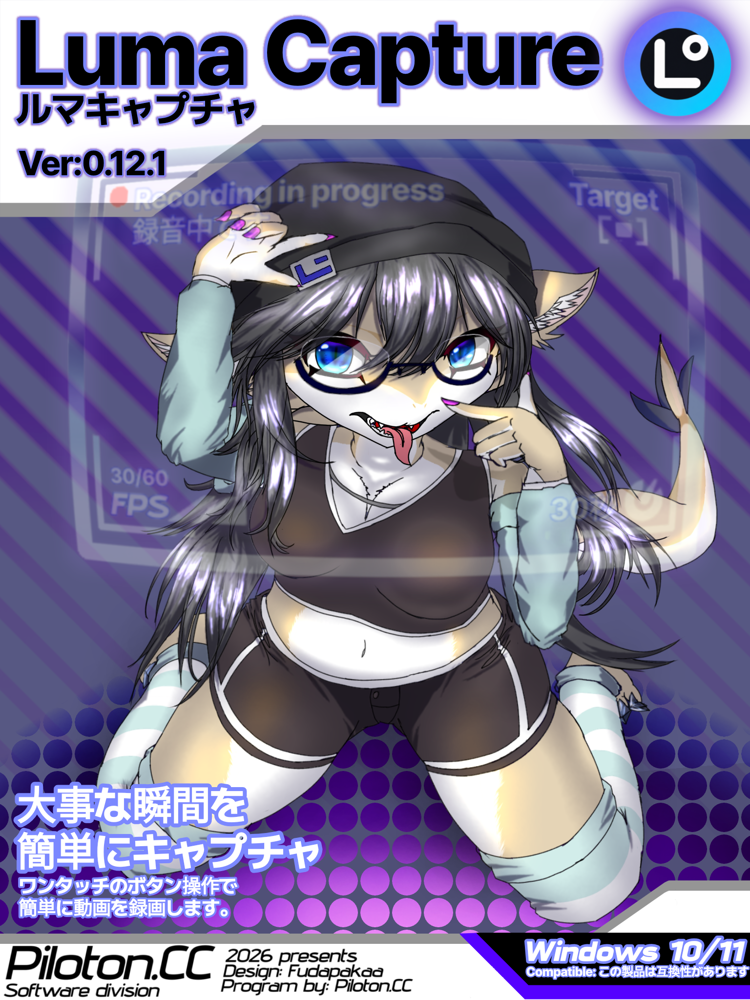

<p align="center">
  
</p>

# LumaCapture

Version 0.12.1 fixes settings being blocked when the application-audio selection is empty, preserves offline audio selections, and supports microphone-only recording. Version 0.12 introduced the simplified dashboard and Windows-session shutdown handling. See RELEASE-0.12.md for details.

LumaCapture は、LumaScreenshot と同じダークUI・常駐操作を採用した Windows 10/11 向け画面録画アプリです。通常録画、アプリ別音声、直前クリップ、容量保護をローカルで行います。

## 主な機能

- `Windows + Shift + C` で録画ダッシュボードを表示。録画対象・画質・解像度・音声・クリップ・保存先を確認でき、ドラッグ移動と位置保存に対応
- 録画UIを常に表示する設定（デフォルトOFF）。待機中は実際に録画される画面・アプリを赤枠で表示
- 赤い録画ボタンで開始／停止。録画中は設定に応じて左上へ `● REC` と経過時間を表示（録画映像からは除外）
- `Alt + C` で直前クリップを保存
- クリップ長は 30・60・120・300・600秒。設定時間に満たない場合も存在する範囲を保存
- 終了時に現在のクリップを保存するか確認する設定
- 全画面（マルチモニター）、メイン画面、指定画面、または選択したアプリウィンドウを録画。ウィンドウはWindows Graphics Captureを使用。前面フルスクリーンではDXGI Desktop Duplicationへ切替（OBSのゲームフック方式とは異なります）
- 画面録画・クリップを開始したまま排他的フルスクリーンのゲームを起動／終了しても、映像停止を検知して録画元を自動再接続
- 対象アプリの終了を定期監視し、検知すると自動停止・保存。最小化中は映像取得を休止します
- 高画質 60 FPS、標準 30 FPS、軽量 30 FPS
- PC内の全音声、または選択した複数アプリの音声だけを録音
- 設定画面で収録対象の音と選択マイクが反応しているか、軽量なリアルタイムバーで確認
- 音声の保存方法を3種類から選択
  - 音声入り MP4（デフォルト）
  - 専用フォルダー内の `Video.mp4` + `MixedAudio.wav`
  - 専用フォルダー内の `Video.mp4` + `Discord.wav` + `Game.wav` のようなアプリ別音声
- 日本語、英語、韓国語、中国語（簡体字・繁体字）の表示切替
- 通常録画、クリップ、分離音声の保存先を設定画面から選択・入力・開く
- 空き容量が指定値を下回ったら通知し、さらに減ったら録画とクリップを自動停止
- タスクトレイ常駐、左クリックで録画UI、右クリックで操作メニュー
- Windowsサインイン時の自動起動、単一起動
- 管理者権限不要のユーザー単位インストーラーとアンインストーラー

## 動作条件

- 通常録画とPC全体音声: Windows 10 バージョン2004（build 19041）以降、または Windows 11
- 特定アプリだけの音声: Windows build 20348 以降（Windows 11 推奨）
- Windows x64
- アプリ単位音声録音は対象アプリが起動している必要があります。
- 完全・排他的フルスクリーンは自動的にDesktop Duplication録画へ切り替わります。DRM・アンチチートなどで保護された映像や音声はWindows側の制限により録画できない場合があります。

## インストール

常駐中のLumaCaptureを終了し、`LumaCapture-Setup.exe` を開いて言語を選択してから「インストール」を押します。日本語・英語・韓国語・中国語（簡体字／繁体字）に対応し、選択言語をアプリにも引き継ぎます。既定のインストール先は `%LOCALAPPDATA%\Programs\LumaCapture` です。配布版は未署名のため、環境によってWindowsの確認画面が表示される場合があります。

## 保存ファイル

既定の保存先は `ビデオ\LumaCapture` です。ファイル名は次の形式です。

- 通常録画: `Recording_yyyy-MM-dd_HH-mm-ss.mp4`
- 直前クリップ: `Clip_yyyy-MM-dd_HH-mm-ss.mp4`
- 分離保存: 録画名のフォルダー内に `Video.mp4` と英語名の `.wav`

## ビルドとテスト

.NET 9 SDK と、[Gyan FFmpeg 8.1.2 essentials](https://www.gyan.dev/ffmpeg/builds/packages/ffmpeg-8.1.2-essentials_build.zip) の `bin/ffmpeg.exe` を `src/LumaCapture/Tools/ffmpeg.exe` に用意し、PowerShellで次を実行します。古いFFmpegではアプリ録画に必要な `gfxcapture` がありません。

```powershell
.\build.ps1
```

ビルドスクリプトはReleaseビルド、映像録画、PC音声、プロセス音声、MP4統合、直前クリップのスモークテスト、自己完結型セットアップEXE、ソースZIP、SHA-256を生成します。

## 参考

保存失敗・強制終了時の元データは、動画保存先の `.LumaCapture-recovery` に保持します。自動削除しません。成功時だけその録画の一時データを削除します。復旧後に不要と確認したセッションだけ手動で削除してください。通常録画中の音声は4 GiB制限を回避するRF64、映像はMKV、完成動画はMP4です。

排他的フルスクリーンはGPU・ゲーム・保護機構に依存します。今回OBSのゲーム注入フックは実装していません。切替検知までの短い区間に他の表示が入る可能性があり、完全なゲーム分離が必要な用途ではOBSのゲームキャプチャを使用してください。

- UI・常駐・自己インストール方式: LumaScreenshot（同梱ソースを設計基準として参照）
- 録画機能と操作項目: [MathewSachin/Captura](https://github.com/MathewSachin/Captura)（MIT、設計参考）
- アプリ単位音声: [Microsoft Application Loopback Audio Capture API](https://learn.microsoft.com/windows/win32/api/audioclientactivationparams/ne-audioclientactivationparams-process_loopback_mode)
- 音声処理: NAudio（MIT）
- 映像処理: FFmpeg（同梱ビルドのライセンスは `THIRD-PARTY-NOTICES.md` を参照）
